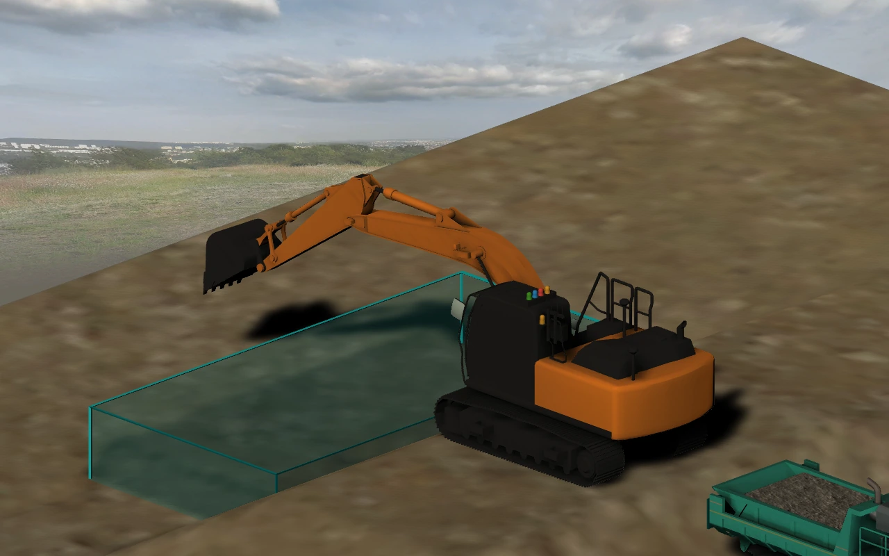
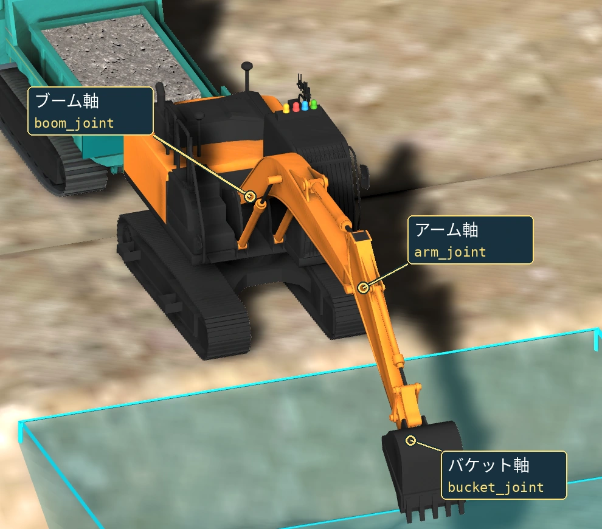
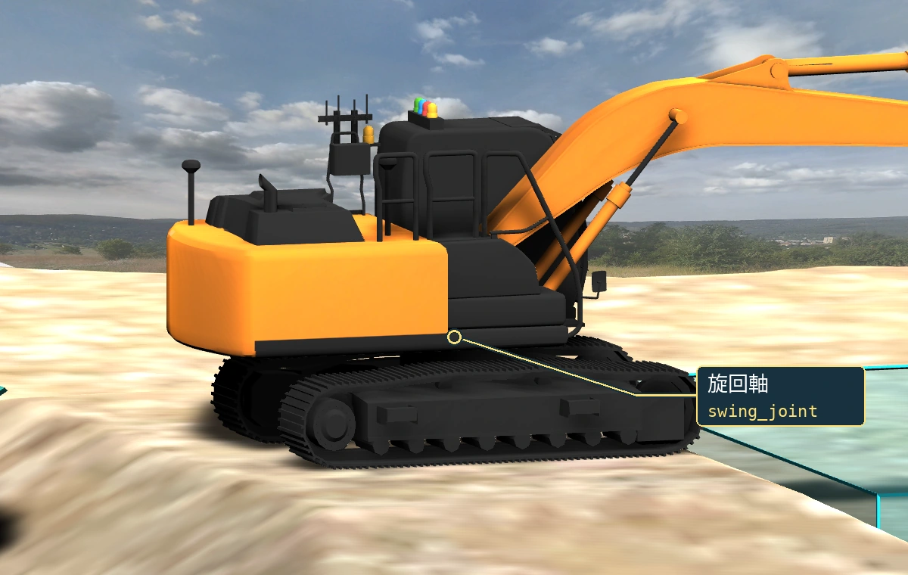
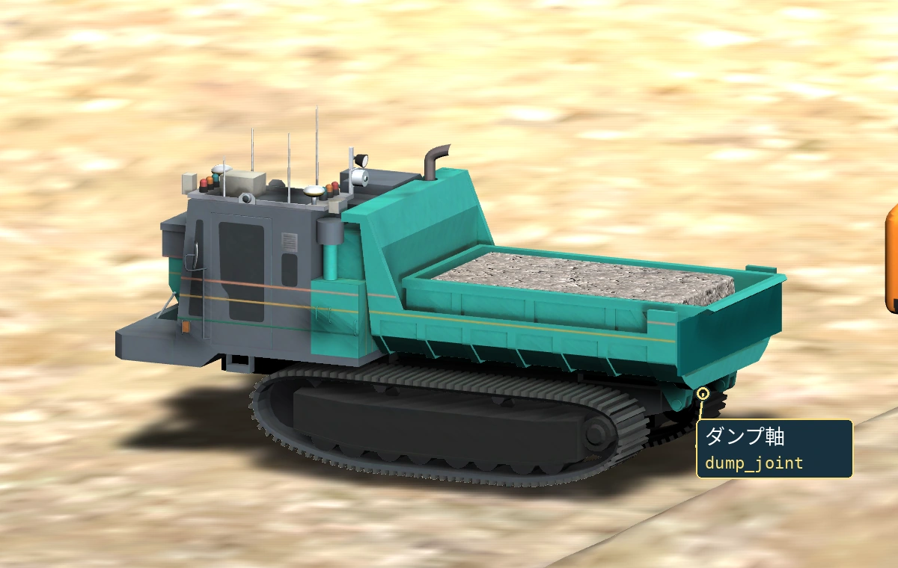
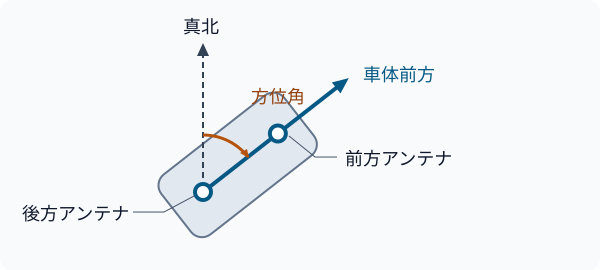

==================================
ハッカソンの建機と実機実験
==================================

ハッカソンのサンプルでは、油圧ショベル ZX200 が土砂を掘って積み込み、クローラダンプ IC120 が土砂を運んで指定の場所に降ろします。土木研究所の建設 DX 実験フィールドでは、この組み合わせで一連の作業を行う実機実験も行われています。

ZX200：土砂を掘ってダンプに積む
---------------------------------

ZX200 は日立建機の油圧ショベルです。ブームとアームでバケットの位置を決め、バケットで土砂をすくいます。車体上部を旋回させることで、クローラを動かさずに掘削場所からダンプの荷台へ土砂を移せます。サンプルの ROS 名前空間は ``/zx200`` です。

   OperaSim-AGX の ZX200。バケットで土砂をすくい、車体上部を旋回させてダンプに積み込みます。

作業能力の目安として、日立建機の `標準機 ZX200-7 の製品仕様 <https://www.hitachicm.com/jp/ja/products/new/medium-excavators/product.zx200-7/>`_ では、運転質量は **20,500 kg**、バケット容量は **0.80 m³** です。実際に一回の掘削で取れる量は土質や掘り方によって変わります。ここで挙げた数値は市販の標準機の仕様例であり、土木研究所の実験機の型式や装備、シミュレータ内の設定値を示すものではありません。

各部の名称と回転軸
~~~~~~~~~~~~~~~~~~~~

   作業機の3軸。丸印は、シミュレータの各関節の中心を画面に投影した位置です。

   旋回軸（``swing_joint``）。クローラを動かさずに上部旋回体だけが左右に回るときの軸です。丸印は車体内部にある軸の中心を画面に投影した位置です。

.. list-table::
   :header-rows: 1

   * - つながる部位
     - ROS の関節名
     - 動き
   * - 下部走行体 → 上部旋回体
     - ``swing_joint``
     - 車体上部を水平に旋回させる
   * - 上部旋回体 → ブーム
     - ``boom_joint``
     - ブームを上げ下げする
   * - ブーム → アーム
     - ``arm_joint``
     - アームを引き込む・伸ばす
   * - アーム → バケット
     - ``bucket_joint``
     - バケットをかき込む・開く

上の4つの関節名は作業機と旋回の指令（``/zx200/front_cmd``）で使います。左右の走行軸は ``left_track`` と ``right_track`` で、走行の指令（``/zx200/track_cmd``）で使います。

IC120：土砂を運んで指定場所に降ろす
--------------------------------------

IC120 は加藤製作所のクローラキャリアです。タイヤの代わりにクローラ（履帯）で走行し、荷台を傾けて土砂を降ろします。サンプルではショベルから積荷を受け取り、放土エリアへ運び、荷台を上げて放土してから積み込み場所へ戻ります。サンプルの ROS 名前空間は ``/ic120_0`` です。

.. figure:: images/machines/ic120.webp
   :alt: シミュレータ内のクローラダンプ IC120。車体の下にクローラ、後ろに荷台がある

   OperaSim-AGX の IC120。クローラで走行し、荷台を傾けて土砂を降ろします。

`加藤製作所の IC120 概略仕様（PDF） <https://www.kato-works.co.jp/products/crawler_carrier/pdf_hicom/IC120.pdf>`_ によると、IC120 の積載荷重は **11,000 kg（11 t）**、機械質量は **14,100 kg** です。積載荷重は土砂の重さで、荷台に入る土砂の体積とは別の指標です。同じ体積でも、土砂の密度が違えば重さは変わります。

荷台のダンプ軸
~~~~~~~~~~~~~~

   ダンプ軸（``dump_joint``）。丸印は、荷台と車体をつなぐヒンジの中心を画面に投影した位置です。放土するときは、この軸を支点に荷台の前側が持ち上がります。

.. note::

   ここで示した仕様は実機の大きさや能力を知るための目安です。ハッカソンの制限や採点はメーカー仕様で決まりません。正式な条件は運営のルールブック、シミュレータの採点の概要は :doc:`scoring` を参照してください。

GPS コンパスと RTK
----------------------------------

GPS コンパスは、車体に固定した2本のアンテナの相対位置から向き（heading）を求めます。移動方向から推定するのではないため、停車中でも向きが分かります。

   アンテナを車体の前後に並べた例。真北から車体前方へ時計回りに測った角度が方位角です。

RTK は基準局の補正情報を使う測位方式で、実際の施工現場でも建機の位置を把握するために使われています。受信条件が良い場合、水平位置の精度は一般に数 cm 程度です。

シミュレータの ``global_pose`` は、建機の位置と姿勢を GPS の測定ノイズを加えずに出力します。

土木研究所が進める「共通制御信号」
--------------------------------------

共通制御信号の目標は、**一度開発した自動施工ソフトウェアで、メーカーの異なる建機を動かせるようにすること** です。そのために、ソフトウェアから建機に送る指令と、建機から返す状態の意味や表し方をそろえます。たとえば油圧ショベルなら、メーカーが違っても、同じ方法でブームの目標角度を指令し、現在の角度を読み取れることを目指します。

ハッカソンの ZX200 では、``/zx200/front_cmd`` で ``boom_joint`` の目標角度を送り、``/zx200/joint_states`` で現在角度を確認できます。この「目標を送り、実際の状態を読み返す」という関係が、共通化の対象を理解する手がかりです。これらの ROS 2 トピック名そのものが共通規格という意味ではありません。

土木研究所の `建設機械の共通制御信号（案） <https://www.pwri.go.jp/team/advanced/pdf/seigyosingou.pdf>`_ には、油圧ショベルの掘削を例に、刃先の目標位置や関節角度などのデータ項目と実装例が示されています。土木研究所は、日立建機・コベルコ建機・小松製作所との `油圧ショベル制御信号の共通化に関する共同研究 <https://www.pwri.go.jp/team/advanced/kyoudou_01.html>`_ を通じて原案の策定を進めてきました。

土木研究所の建設 DX 実験フィールド
-------------------------------------

茨城県つくば市の土木研究所にある `建設 DX 実験フィールド（建設機械屋外実験施設） <https://www.pwri.go.jp/team/advanced/facilities.html>`_ は、建機の遠隔操作や自動施工を実機で試す屋外施設です。土木研究所の `自動施工技術基盤 OPERA <https://www.pwri.go.jp/team/advanced/opera.html>`_ は、自動運転に対応した建機、実験フィールド、無線通信システム、シミュレータ、ミドルウェアを研究開発向けに提供しています。

`ZX200 と IC120 を使った実機実験（論文 4.2 節・図12） <https://robotics.ait.kyushu-u.ac.jp/kurazume/papers/SCR25-1.pdf>`_ では、ZX200 が土山から掘った土砂を IC120 に積み込み、IC120 が指定地点で放土して戻る作業を繰り返しました。`2025年8月の公開実証 <https://www.pwri.go.jp/jpn/research/sip/R7_achieve/251006_sub_A.html>`_ でも、このフィールドで複数の建機による掘削・運搬・放土が行われています。施設紹介にはフィールドの写真、実験論文には実機が作業する様子が掲載されています。
