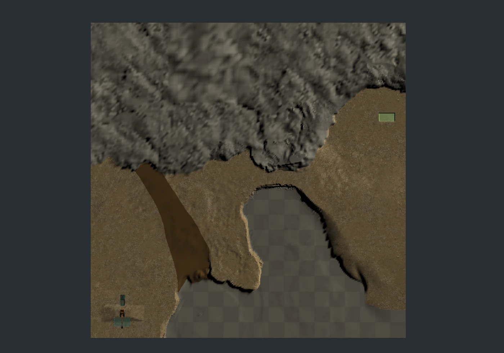
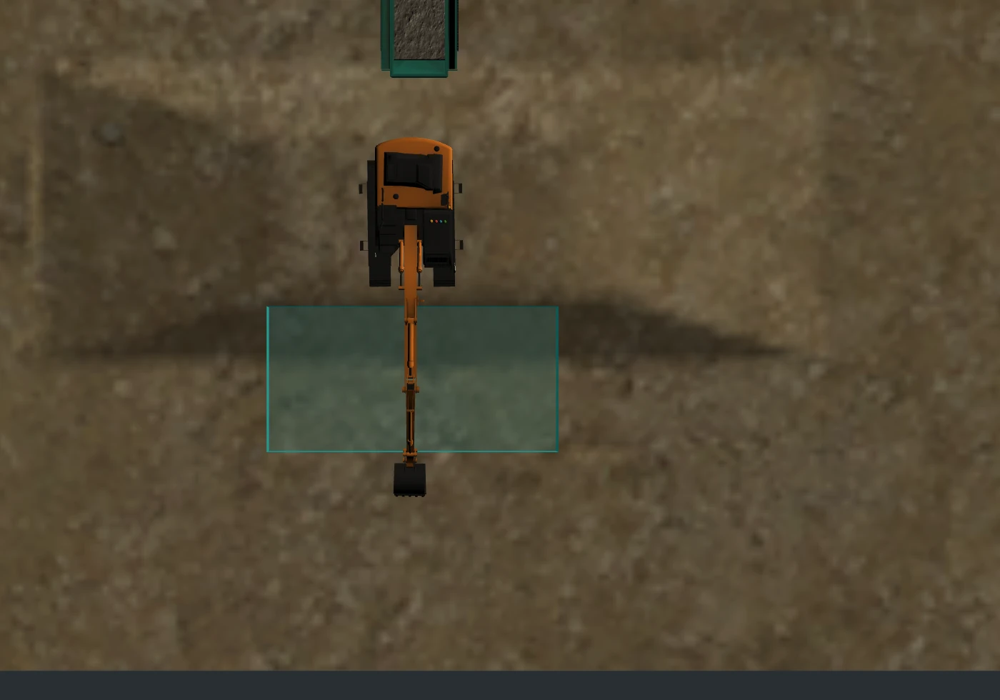
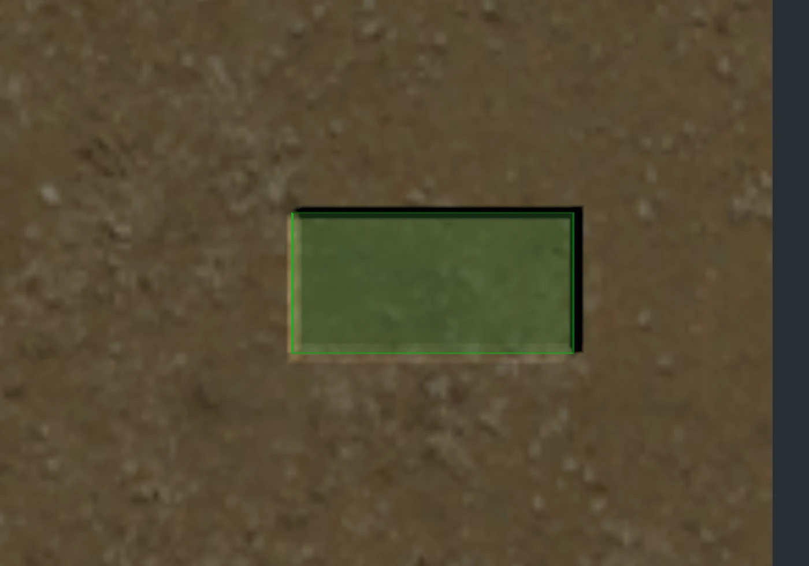
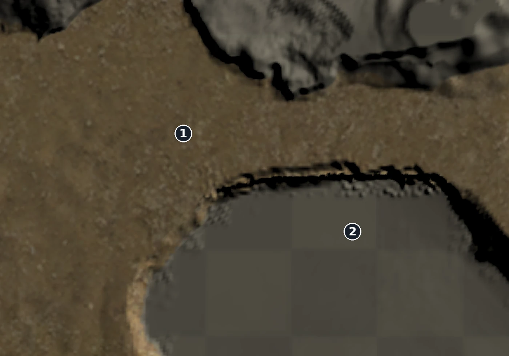
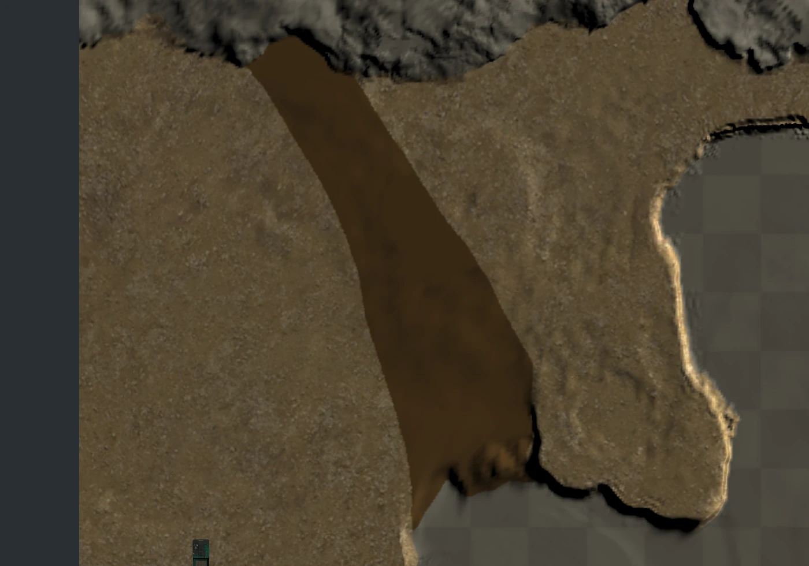

======================
スコアの加点・減点
======================

.. important::

   **競技の配点、判定条件、例外、最終評価の詳細は、必ず運営が参加者に案内する最新版のルールブックを参照してください。** このページはシミュレータのスコア表示を読むための概要です。記載が異なる場合は、ルールブックと運営の案内を優先してください。

   `土木研究所の募集要項 <https://www.pwri.go.jp/team/advanced/opera-hackathon-2.html>`_ では、詳細ルールは開催前に参加者へ通知すると案内しています。審査員による総合評価と、シミュレータのスコアは区別してください。

画面で見分ける5つのエリア
----------------------------

Unity の競技シーンを真上から撮影した画像です。全景では、左下に掘削エリア、右上に放土エリアがあります。

   競技フィールドの全景

   **掘削エリア（水色の枠）**：枠内で地面を掘ると、減った土量が P01 の加点対象になります。

   **放土エリア（緑の枠）**：ここに土砂を降ろすと、堆積した土量が P03 の加点対象になります。

   **走行可能エリアと進入禁止エリア**：①は画像を左右に横切る走行可能な道、②は道から外れた進入禁止エリア内の地点です。番号は位置の目安で、境界線ではありません。進入禁止エリアに滞在すると、M03 の減点対象になります。

   **ぬかるみエリア（濃い茶色の帯）**：クローラダンプがこの帯の同じ区画を繰り返し通ると、M04 の減点対象になります。

加点：掘削・積み込み・積み降ろし
------------------------------------

.. list-table::
   :header-rows: 1
   :widths: 1 2 3 6

   * - ID
     - 項目
     - 初期設定の配点
     - 計算方法
   * - P01
     - 掘削
     - 0.5 m³ 相当で +1 点（2 点/m³）
     - 掘削エリアで、初期状態から減った地形の体積を求めます。前回得点を反映した時点より減少量が大きければ、その差に係数を掛けます。
   * - P02
     - 土砂積込み
     - 0.1 m³ 相当で +1 点（10 点/m³）
     - クローラダンプの荷台に載った土砂の体積を前回の計測値と比べ、増えた分に係数を掛けます。荷台の土砂が減っても、この項目では減点しません。
   * - P03
     - 土砂積降ろし
     - 0.1 m³ 相当で +10 点（100 点/m³）
     - 放土エリアで初期状態から増えた堆積量を求めます。判定に使う堆積量は、全ダンプの積載量の減少から求めた累計放出量が上限です。その値が過去の最大値を超えた分に係数を掛けます。

たとえば、判定に使う堆積量が、過去最大の 0.125 m³ から 0.25 m³ に増えたとします。P03 では、増加分の 0.125 m³ に 100 点/m³ を掛け、12.5 点を積算します。繰り越しがなければ +12 点を反映し、0.5 点を次回に繰り越します。荷台から土砂が減るだけでは加点されません。

減点：地形の変形・衝突・走行
----------------------------------

.. list-table::
   :header-rows: 1
   :widths: 1 2 3 6

   * - ID
     - 項目
     - 初期設定の配点
     - 計算方法
   * - M01
     - 地形変形
     - 0.5 m³ 相当で −1 点（−2 点/m³）
     - 指定の掘削・放土エリア以外の地面に土砂が積もり、集計した地形の体積が初期状態より増えると減点対象になります。前回減点を反映した時点より増加量が大きければ、その差に係数を掛けます。
   * - M02
     - 衝突
     - 判定1回で −5 点
     - クローラダンプ側で、別の対象建機との接触が解けた時点で判定します。同じクローラダンプの判定では、前回の衝突減点からシミュレーション時間で1秒未満の接触終了は数えません。
   * - M03
     - コースアウト
     - 滞在1秒につき −1 点
     - 油圧ショベルまたはクローラダンプが進入禁止エリアに連続して滞在した時間を、建機ごとにシミュレーション時間で計ります。1秒単位で減点し、エリアを出ると1秒未満の残りはリセットします。
   * - M04
     - コースラップ
     - 重複通過1回で −1 点
     - 泥濘（ぬかるみ）エリアを 0.5 m 四方の区画に分け、クローラダンプ間で通過回数を共有します。別の区画へ移動したときに通過回数を増やし、その区画の2回目以降を減点します。

M01 は、たとえば次のように指定エリア外の地面に土砂が積もったときに関係します。

- ダンプが緑の枠から離れた走行路で土砂を降ろし、路面に土砂が積もると、M01 の減点対象になります。
- 水色の枠の外を掘っても、P01 の掘削加点にはなりません。掘った場所の地面が低くなるだけでは M01 にもなりませんが、掘り出した土砂が走行路などに積もり、対象となる地形の体積が全体で増えると、M01 の減点対象になります。

実際の施工現場では、ぬかるみで同じ場所を何度も通ると、わだち（車輪やクローラの通った跡）が深くなり、走行しにくくなることがあります。M04 では、わだちの深さを測る代わりに、同じ区画を繰り返し通ると減点します。

体積と端数の扱い
------------------

地形を使う P01・P03・M01 では、高さの変化を集計し、実際の高さと計測点間の面積から体積（m³）に換算します。体積に係数を掛けた値は、絶対値が1点以上になった時点で整数部分をスコアに反映し、端数を繰り越します。荷台の体積を使う P02 も、点数の端数は同じように扱います。

P01 と M01 は、整数点を反映したときに比較の基準を更新します。それまでは、基準からの同じ体積差が複数回の計測で積算される場合があります。表の体積あたりの点数は係数の換算値です。

合計スコアには各項目の整数点を加算します。合計が減点前にすでに −100 点以下の場合、初期設定ではその減点を加えず、合計を −100 点にします。−100 点より上からの減点では、−100 点を下回ることがあります。

スコア表示の確認
------------------

項目名と ID は、シミュレータが記録する ``score_events.log`` の表記に合わせています。画面で合計を確認する場合は、シミュレーション開始前に **Total Score** をオンにしてください。操作方法は :doc:`simulator-operation` を参照してください。
