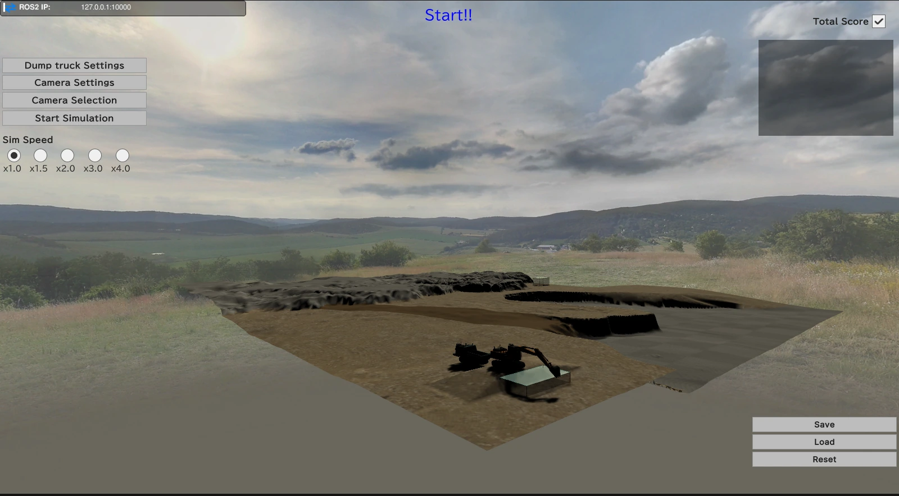
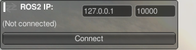
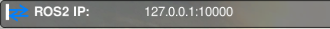
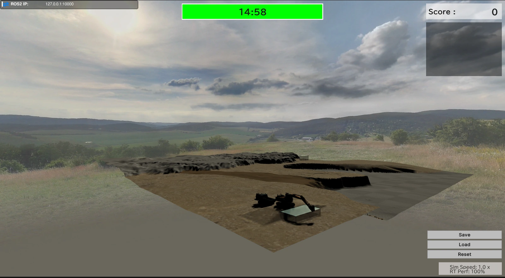
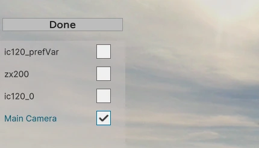
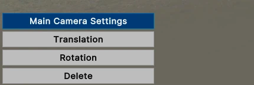
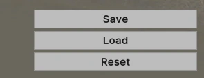

==============================
シミュレータの起動と基本操作
==============================

この章では、セットアップを終えたシミュレータ（Unity Editor の Play またはビルド済みプレイヤー）を起動し、カメラを動かし、セーブ・ロード・リセットを行い、安全に停止するまでを説明します。

起動とセットアップ画面
------------------------

1. シミュレータを起動します。Unity Editor の場合は ``GameScene`` を開いて **Play** を押します。プレイヤーの場合は、実行ファイルを起動します（カレントディレクトリにライセンスがある必要があります。 :doc:`agx-license` を参照してください）。
2. 起動直後には、 **セットアップ用の画面** が表示されます。この時点では、物理シミュレーションはまだ動いていません。建機と地形は、配置モードの状態です。
3. 画面左のメニューには、次の項目があります。 **Total Score** は画面右上にあります。

   - **Dump truck Settings**：ダンプトラック（クローラダンプ）を配置します。
   - **Camera Settings**：カメラを配置します。
   - **Camera Selection**：使用するカメラを選びます。
   - **Start Simulation**：シミュレーションを開始します。
   - **Sim Speed**：倍速を選びます（x1.0、x1.5、x2.0、x3.0、x4.0）。
   - **Total Score**：スコア表示のオン・オフを切り替えます。

4. 配置を変えたいときは、Dump truck Settings と Camera Settings で、建機とカメラを配置します。最初のサンプル実行では、初期配置のままで問題ありません。
5. **Sim Speed** と **Total Score** は、開始前に決めます。 **Sim Speed** は、まず **x1.0** にするのが安全です。このメニューは **Start Simulation を押すと消える** ため、Sim Speed、Total Score、Camera Selection の選択は、すべて開始前に済ませてください。開始後に Sim Speed を変えることはできません。変えたいときは、シミュレーションを停止してリセットし、次の実行で選び直します。
6. 使うカメラも、 **Start Simulation の前** に **Camera Selection** で選んでおきます。実行中は、このメニューは使えません。 **C** キーで、カメラを順番に切り替えられます。
7. **Start Simulation** を押すと、シミュレーションが始まります。内部では ``GlobalVariables.changeActionMode(3)`` が呼ばれ、AGX の物理ステップが有効になります。Unity のログに ``Physics Start!`` が出ていることを確認してください。出ていなければ、物理シミュレーションは始まっていません。

   開始前の画面。左で倍速を、右上でスコア表示の有無を選んでから、 **Start Simulation** を押します。

左上の **Ros2 IP** は、シミュレータが接続する ROS-TCP-Endpoint のアドレスです。画像の ``127.0.0.1:10000`` はシミュレータと同じ PC を指します。別の Linux PC で endpoint を動かす場合は、その PC の IP アドレスとポート ``10000`` を指定します。

Unity Editor では、 **Play を押す前に Robotics > ROS Settings** で Protocol を **ROS2** にし、接続先 IP とポートを設定します。配布プレイヤーでは、 **Connect On Start** が無効で HUD が表示される場合に、HUD で接続先を入力して **Connect** を押せます。自動接続が始まっていて入力欄が無効な場合は、 :ref:`windows-ros-ip` を参照してください。

   自動接続を無効にしたときの HUD。左の欄に Linux 側 PC の IP アドレス、右の欄に ``10000`` を入力し、 **Connect** を押します。

HUD 左端の矢印で接続状態を確認できます。手動接続前は灰色です。接続先に到達できないなど、接続エラーがあると赤くなります。接続に成功すると赤から青に変わり、IP アドレスとポートが表示されます。

   接続エラー：赤い矢印が続く場合は、endpoint が起動しているか、接続先の IP アドレスとポートが正しいかを確認します。

   接続成功：矢印が青になります。青は TCP 接続の目印です。ROS 2 のトピックが実際に流れているかは、 :doc:`sample-run` の疎通確認に従って確認してください。

   実行中の画面。開始前のメニューが消え、残り時間が表示されます。

カメラ操作
------------

配置モード（建機やカメラを置く画面）では、マウスで視点を動かせます。ただし、条件があります。ソースコード上、視点の移動が有効になるのは、 **Main Camera（メインカメラ）モード** （ ``GlobalVariables.SetMoveType == 3`` ）が選ばれていて、かつカメラやオブジェクトが選択されていないときだけです。建機やカメラを選択している間は、視点の移動ではなく、オブジェクトの操作になります。

   **Camera Selection** で使用するカメラにチェックを入れ、 **Done** で確定します。

   配置モードでは、左下の **Main Camera Settings** でメインカメラを操作するモードに切り替えます。

- **ホイール**：前後に移動します（ズーム）。
- **左ドラッグ**：平行移動します（パン）。
- **右ドラッグ**：視点を回転します。
- **C キー**：カメラを順番に切り替えます（セットアップ中、実行中のどちらでも使えます）。
- **Q キー**：カメラの一覧を取得し直して、有効にし直します。
- **中クリック**：配置モードで、建機またはカメラを追加します。

カメラが反応しなくなったときは、 **Q** キーで有効にし直してみてください。

セーブ・ロード・リセット
--------------------------

メニューの Save、Load、Reset を使います。

   画面右下の **Save**、 **Load**、 **Reset**。操作前に下の注意事項を確認してください。

- **Save**：現在の地形、建機、カメラ、残り時間、スコアを保存します。保存先は ``Assets/SaveData/setting`` と ``Assets/SaveData/simulation`` の 2 か所で、どちらも **同名のファイルを上書きします** 。プレイヤーの場合、この相対パスは、実行ファイルのカレントディレクトリが基準になります。
- **Load**：保存した状態を復元します。
- **Reset**：初期状態に戻します。 **ROS 側のタスクの状態はリセットされません** 。新しく実行を始めるときは、ミドルウェア側も起動し直してください。

.. warning::

   セーブ、ロード、リセットは、状態を上書きします。実行する前に、 ``Assets/SaveData`` 以下（プレイヤーの場合は、対応する出力先）をバックアップしてください。また、Save は残り時間を記録しますが、物理シミュレーション全体を一時停止する機能ではありません。シミュレーションを止めたいときは、次の「安全な停止」の手順を使ってください。

.. _simulator-safe-stop:

安全な停止
------------

シミュレーションを止めるとき、または終了するときは、次の順番で行います。endpoint と物理シミュレーションを先に止めてしまうと、非常停止のコマンドを届けられなくなります。順番を守ってください。

1. **自律制御ノードを止めます。** Linux 側で ``task_manager`` などを起動したターミナルで ``Ctrl+C`` を押します。自律ノードを止めずに Unity だけを閉じると、最後に送られた指令が残ります。
2. **制御中の機体すべてに非常停止を送ります。** endpoint と物理シミュレーションを動かしたまま、各機体の ``/<機体名>/emg_stop_cmd`` （ ``std_msgs/msg/Bool`` ）に ``true`` を送ります。機体名は ``ros2 topic list`` で確認します。ZX200 と IC120 の両方を制御している場合は、両方に送ります。

   非常停止は制御を無効にする指令です。指令が届くことや即座に停止することは保証されないため、各機体が実際に止まったことを確認してください。送信コマンドは :doc:`development` の「非常停止」を参照してください。

3. **Unity を終了します。** Play を止めるか、プレイヤーを閉じます。ROS 通信がすでに使えない場合は、非常停止の送信を待たずに Unity を終了してください。最後の指令が残ることがあるため、次の実行前にシーンを開き直すか、Reset を行います。
4. **endpoint を止めます。** endpoint を起動したターミナルで ``Ctrl+C`` を押します。ホスト版は Linux ホスト側、Docker 版はコンテナ内のターミナルです。Docker コンテナも止める場合は、ホスト側で ``docker stop opera-hackathon-sample`` を実行します。

非常停止を解除するには ``false`` を送ります。解除前に、自律制御ノードが止まっていることを確認してください。

ログの場所
------------

- Unity Editor：Console ウィンドウ、または ``%LOCALAPPDATA%\Unity\Editor\Editor.log``
- ビルド済みプレイヤー（Windows）： ``%USERPROFILE%\AppData\LocalLow\VMC Motion Technologies\PWRI_KenkiSimulator\Player.log`` （Company Name と Product Name が既定値の場合）

繰り返し実行するときのコツ
----------------------------

- 毎回同じ初期状態から始めたいときは、シーンを開き直すか、Load や Reset を使います。地形や配置が変わったまま次の実行を始めると、結果を比べられません。ただし、Reset は ROS 側のタスクの状態をリセットしないので、ミドルウェア側は起動し直してください。Sim Speed や Total Score を変えたいときも、停止とリセットをしてから、次の実行で選び直します。
- 倍速を上げると、負荷が高くなります。まず x1.0 で確認し、動作が重いときは、Windows 側の要因（CPU、AGX の物理演算、Unity の描画負荷）を切り分けてください。Linux 側の ``start-nvidia.sh`` は、ROS の GUI の描画に関係するもので、Unity シミュレータの軽さには影響しません（ :doc:`linux-middleware` を参照してください）。
- ROS 側のトピックが流れているかどうかは、Linux 側で ``ros2 topic list`` や ``ros2 topic hz /zx200/joint_states`` などを使って確認します。詳しくは :doc:`linux-middleware` と :doc:`development` を参照してください。
